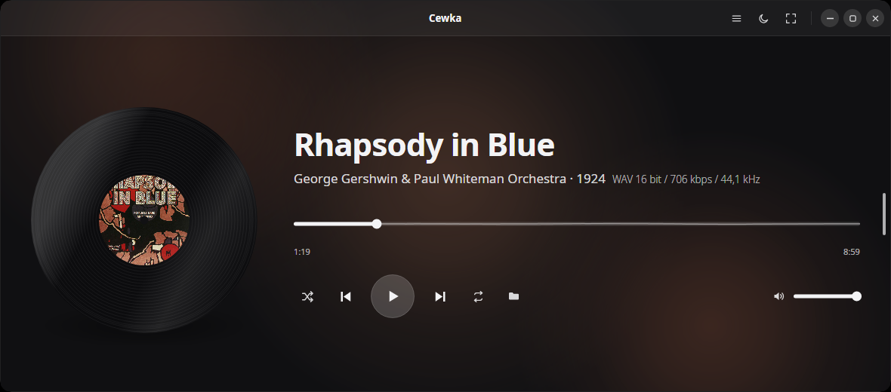
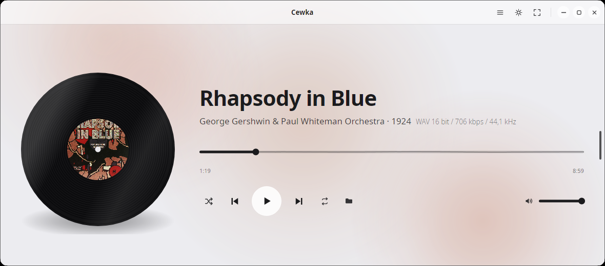
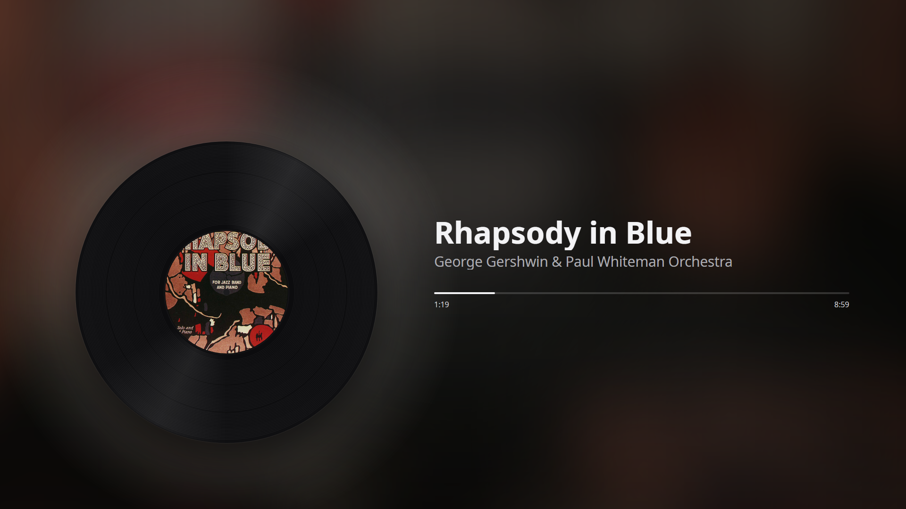
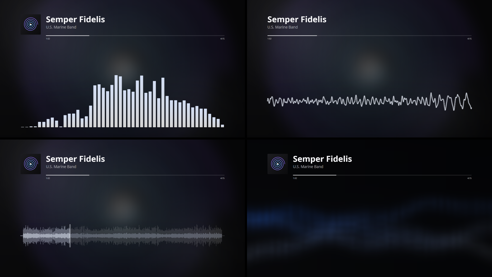
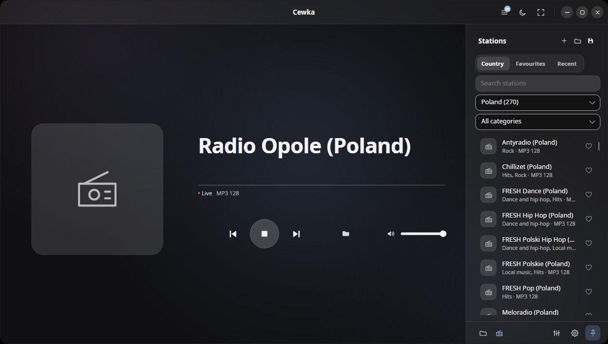
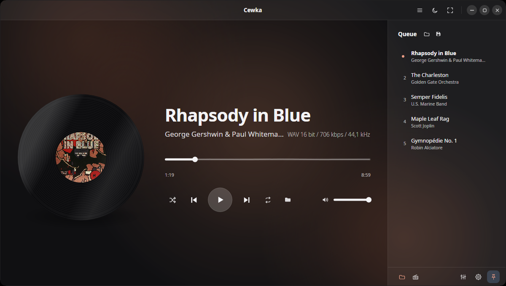
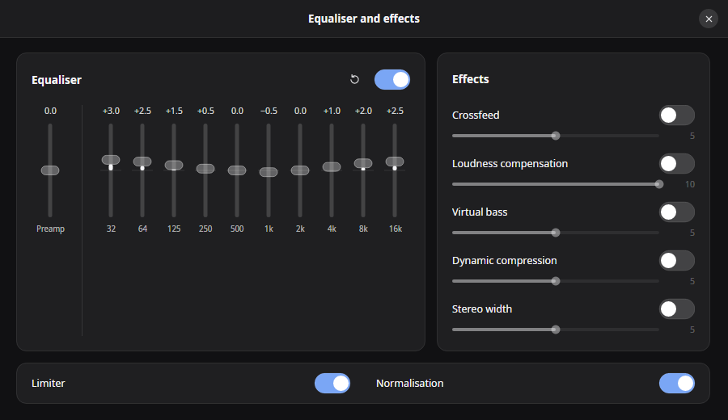
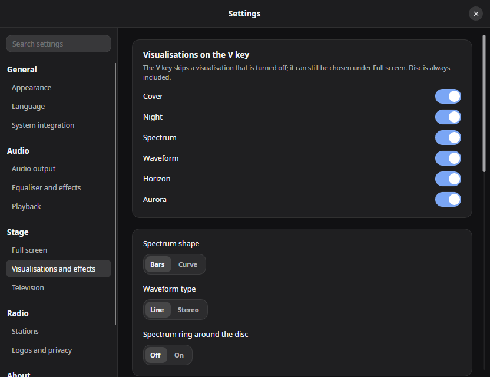

# Cewka

A minimalist music player for Linux and Windows. A single file, no installer and no separate
.NET runtime.


*[Wersja polska](README.md)*



## Why I built this

I couldn't find a configurable, good-looking music player for my Fedora setup, so I wrote one
myself. I wanted something that just plays files from disk, has an equalizer and looks good,
without a library, an account or service integrations. Apart from playing radio stations and an
optional update check, it does not go online.

You open files or whole folders, it puts them in a queue and plays them. The window background
takes its colors from the album cover.



## Features

- MP3, FLAC, WAV, Ogg Vorbis and Opus. AAC, M4A and ALAC through the system codecs: Media
  Foundation on Windows, GStreamer on Linux.
- Gapless playback.
- Ten-band equalizer with a preamp and a limiter.
- Five effects, all off by default: headphone crossfeed, loudness compensation for quiet
  listening, virtual bass, dynamic range compression and stereo widening.
- Volume leveling from ReplayGain tags or Cewka's own EBU R128 measurement, to −23, −18 or
  −14 LUFS.
- M3U playlists.
- Light and dark themes, twenty interface languages, including Simplified Chinese, Japanese
  and Brazilian Portuguese.
- System media panel (MPRIS on Linux, the overlay on Windows) and media keys.
- Keyboard and screen reader support.
- Full-screen stage (F11, the title bar button or a double click on the disc): a blurred cover in the
  background, the title, a progress bar and buttons that fade out after a few seconds without input.
  The V key switches the visual: Disc, Cover, Night, Spectrum, Waveform (a line or stereo),
  Horizon (the envelope of the whole track with a playhead) and Aurora
  (ribbons of light in the cover colors, drawn by a shader; only with a GPU and on mains power).
  Spectrum, Waveform and Aurora have a flash limiter: the brightness of the picture never
  changes enough to exceed three transitions per second. With reduced motion the Disc replaces them,
  and on battery it also replaces Aurora. Settings (Stage) choose the visualisations on the V key,
  the position, alignment and margins of the text, the size of the disc and cover, and background
  effects for Disc and Cover in the cover colours: blobs, glow, a tinted blur and specks of light.
- Living-room display support: a choice of the screen the stage opens on, a margin remembered
  separately for each screen (none, 2.5% or 5%; "Fit edges" shows a frame that the arrow keys
  adjust), three text sizes, a screen-saver block and OLED care: slow drift of the picture, dimming
  of static text after three minutes without input, and the disc and text swapping sides when the
  track changes while the controls are hidden. Unplugging the stage's screen closes the stage.
- Internet radio with a built-in list of over seven hundred stations (country, category, search,
  favorites, recently played), your own addresses and M3U and PLS import. Stations play as MP3 and
  AAC, including over HLS; track titles show when the station sends them. Ctrl+1 (files) and Ctrl+2
  (radio) switch the source. Cewka then connects to the broadcasters' servers, which see your IP
  address: it fetches the stream of the chosen station and, after the one-time banner is dismissed
  or a station is started, the logos of the stations on screen (HTTPS only, cached on disk). No
  cookies, identifiers or telemetry. Radio as a whole can be turned off in
  Settings under Radio › Stations, and logo downloads under Radio › Logos and privacy.
- Update check, off by default. It asks GitHub for the latest release number, at most once a day.







The equalizer with effects opens in its own window with the button in the top right corner or the Q key,
and the queue (the station list in radio mode) slides out when the pointer rests on the handle at the right edge of the window; the L key pins it in place. The same equalizer and effect settings
are in Settings under Audio › Equaliser and effects. The other shortcuts are listed in Settings under About › Information.
Settings have main categories (General, Audio, Stage, Radio, About) with subcategories, and small
flags next to the languages. The field above the sidebar (Ctrl+F) searches all settings. Settings also
cover soft pause, the speed of the disc rotation, background motion and spectrum fall, the length of the
recently played station list, and playing the last station when the app opens in radio mode.







## Installation

Packages are on the [releases page](https://github.com/grelix/cewka/releases). After installing,
Cewka shows up in the application menu.

Fedora, RHEL:

```bash
sudo dnf install ./cewka-1.0.0-1.x86_64.rpm
```

openSUSE:

```bash
sudo zypper install ./cewka-1.0.0-1.x86_64.rpm
```

Debian, Ubuntu, Linux Mint:

```bash
sudo apt install ./cewka_1.0.0_amd64.deb
```

Arch, Manjaro:

```bash
sudo pacman -U cewka-1.0.0-1-x86_64.pkg.tar.zst
```

On Windows, download `Cewka.exe` and run it. The file isn't signed, so SmartScreen will warn you
the first time. You can check the download against `SHA256SUMS.txt` from the release, for
example with `Get-FileHash Cewka.exe` in PowerShell.

### AAC, M4A and ALAC on Linux

These formats need the libav decoder for GStreamer. Everything else works without it.

```bash
sudo dnf install gstreamer1-libav        # Fedora, from RPM Fusion
sudo apt install gstreamer1.0-libav      # Debian, Ubuntu
sudo pacman -S gst-libav                 # Arch
```

## Building

You need the .NET 10 SDK and a C compiler: gcc on Linux, Visual Studio Build Tools on Windows.

```bash
./native/build-linux.sh
dotnet run --project src/Cewka.App -- ~/Music/Album
```

`./tools/publish-linux.sh` and `./tools/build-packages.sh` build the single-file release and the
packages. On Windows use `native\build-windows.cmd` and `tools\publish-windows.cmd`.

## What it's made of

C# and [Avalonia](https://avaloniaui.net/). Audio goes through [miniaudio](https://miniaud.io/),
which also decodes MP3, FLAC and WAV. Ogg Vorbis is handled by [NVorbis](https://github.com/NVorbis/NVorbis),
Opus by [Concentus](https://github.com/lostromb/concentus), and everything else, including AAC from radio stations, by the system codecs. The visuals are drawn by Skia, which ships with Avalonia.

## License

MIT, see [LICENSE](LICENSE). Third-party notices are in [THIRD-PARTY-NOTICES.txt](THIRD-PARTY-NOTICES.txt),
with a list of components in [docs/licencje.md](docs/licencje.md) (in Polish). The screenshots show
Rhapsody in Blue with the cover of the 1924 first sheet music edition, which is in the public domain.
The recordings in the queue and on the visualisation screenshot come from Wikimedia Commons and are
in the public domain too: The Charleston (Golden Gate Orchestra, 1925), Semper Fidelis (U.S. Marine
Band, 1909), Maple Leaf Rag (Scott Joplin, 1916 piano roll) and Erik Satie's Gymnopédie No. 1 played
by Robin Alciatore (Musopen).
