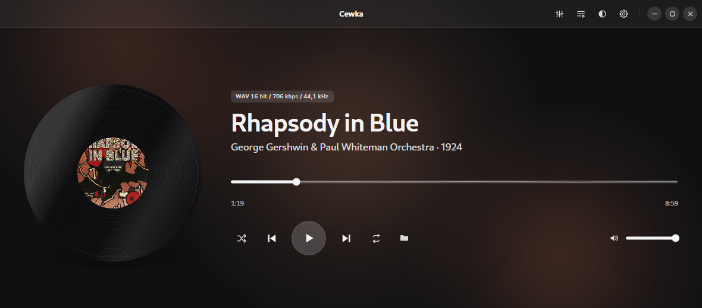
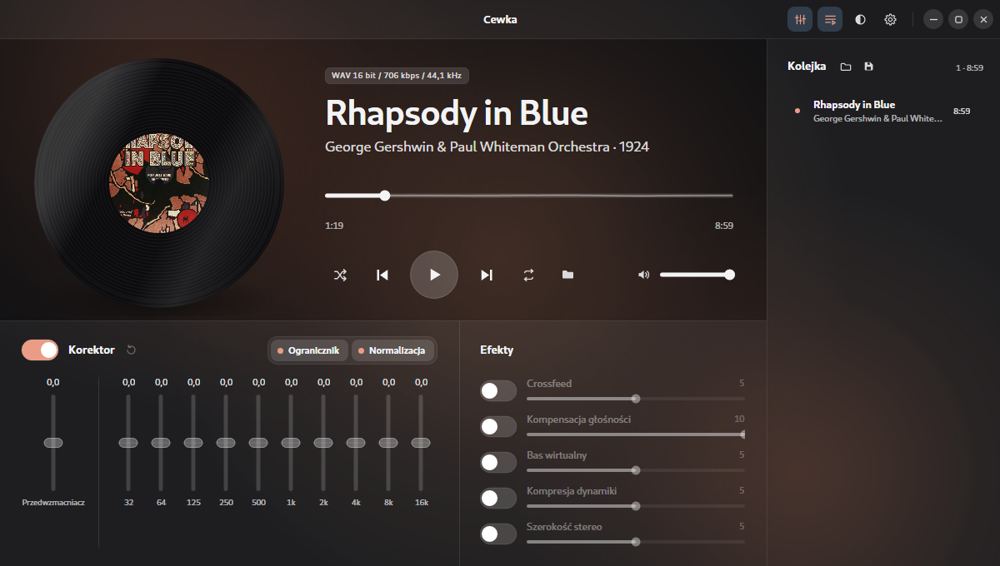
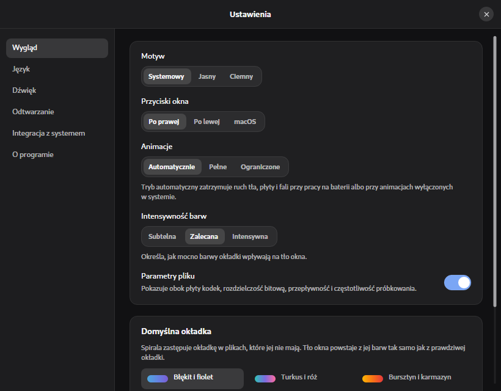

# Cewka

Minimalistyczny odtwarzacz muzyki dla Linuksa i Windowsa. Jeden plik, bez instalatora i bez
osobnego środowiska .NET.


*[English version](README.en.md)*



## Dlaczego to napisałem

Brakowało mi konfigurowalnego i ładnego odtwarzacza na moją Fedorę, więc zrobiłem go sam.
Chciałem czegoś, co po prostu gra pliki z dysku, ma korektor i dobrze wygląda, a do tego obywa się
bez biblioteki, konta i integracji z serwisami.

Otwiera się w nim pliki albo całe foldery, a on układa je w kolejkę i gra. Tło okna bierze barwy
z okładki albumu.


## Możliwości

- MP3, FLAC, WAV, Ogg Vorbis i Opus. AAC, M4A i ALAC przez kodeki systemu: Media Foundation
  w Windowsie, GStreamer w Linuksie.
- Przejścia między utworami bez przerwy.
- Korektor dziesięciopasmowy z przedwzmacniaczem i ogranicznikiem.
- Pięć efektów, domyślnie wyłączonych: crossfeed do słuchawek, kompensacja głośności przy cichym
  słuchaniu, bas wirtualny, kompresja dynamiki i poszerzenie stereo.
- Wyrównanie głośności według znaczników ReplayGain albo własnego pomiaru EBU R128, do poziomu
  −23, −18 albo −14 LUFS.
- Listy odtwarzania M3U.
- Motyw jasny i ciemny, siedemnaście języków interfejsu.
- Panel multimediów systemu (MPRIS w Linuksie, nakładka w Windowsie) i klawisze multimedialne.
- Obsługa z klawiatury i przez czytnik ekranu.
- Sprawdzanie nowej wersji, domyślnie wyłączone. Tylko wtedy Cewka łączy się z siecią: pyta
  GitHuba o numer najnowszego wydania, najwyżej raz na dobę.

Korektor z efektami i kolejkę pokazuje się przyciskami w prawym górnym rogu okna albo klawiszami
Q i L. Pozostałe skróty są w ustawieniach, w zakładce O programie.





## Instalacja

Pakiety są na stronie [wydań](https://github.com/grelix/cewka/releases). Po instalacji program
pojawia się w menu aplikacji.

Fedora, RHEL, openSUSE:

```bash
sudo dnf install ./cewka-0.9.0-1.x86_64.rpm
```

Debian, Ubuntu, Linux Mint:

```bash
sudo apt install ./cewka_0.9.0_amd64.deb
```

Arch, Manjaro:

```bash
sudo pacman -U cewka-0.9.0-1-x86_64.pkg.tar.zst
```

W Windowsie wystarczy pobrać `Cewka.exe` i go uruchomić. Plik nie jest podpisany, więc za pierwszym
razem pojawi się ostrzeżenie SmartScreen. Pobrany plik można porównać z sumą z `SHA256SUMS.txt`
dołączonego do wydania, na przykład poleceniem `Get-FileHash Cewka.exe` w PowerShellu.

### AAC, M4A i ALAC w Linuksie

Te formaty wymagają dekodera libav dla GStreamera. Bez niego pozostałe formaty działają normalnie.

```bash
sudo dnf install gstreamer1-libav        # Fedora, z RPM Fusion
sudo apt install gstreamer1.0-libav      # Debian, Ubuntu
sudo pacman -S gst-libav                 # Arch
```

## Budowanie

Potrzebny jest .NET SDK 9 i kompilator C: gcc w Linuksie, Visual Studio Build Tools w Windowsie.

```bash
./native/build-linux.sh
dotnet run --project src/Cewka.App -- ~/Muzyka/Album
```

Wydanie jednoplikowe i pakiety budują `./tools/publish-linux.sh` i `./tools/build-packages.sh`.
W Windowsie są to `native\build-windows.cmd` i `tools\publish-windows.cmd`.

## Z czego jest zrobiona

C# i [Avalonia](https://avaloniaui.net/). Dźwięk idzie przez [miniaudio](https://miniaud.io/),
który dekoduje też MP3, FLAC i WAV. Ogg Vorbis obsługuje [NVorbis](https://github.com/NVorbis/NVorbis),
Opusa [Concentus](https://github.com/lostromb/concentus), a pozostałe formaty kodeki systemu.

## Licencja

MIT, treść w pliku [LICENSE](LICENSE). Noty składników są w [THIRD-PARTY-NOTICES.txt](THIRD-PARTY-NOTICES.txt),
a ich wykaz w [docs/licencje.md](docs/licencje.md). Zrzuty pokazują „Rhapsody in Blue” w nagraniu z 1924 roku
z okładką pierwszego wydania nut, która jest w domenie publicznej.
