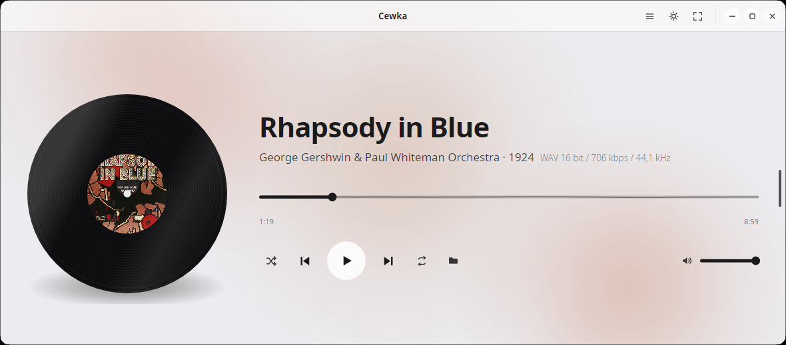
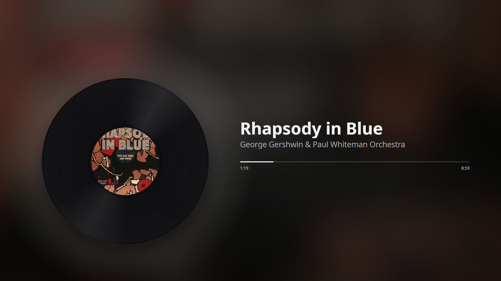
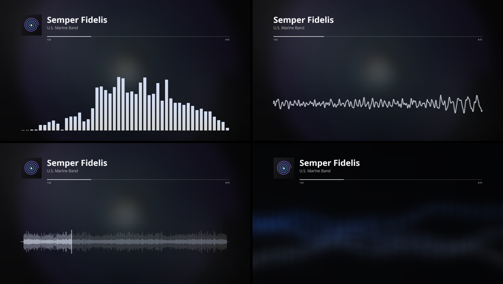
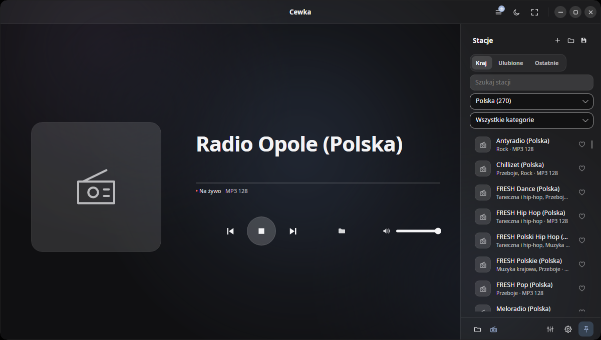
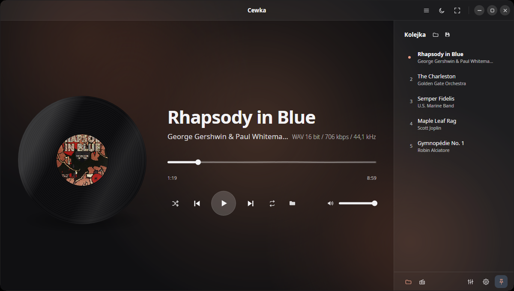
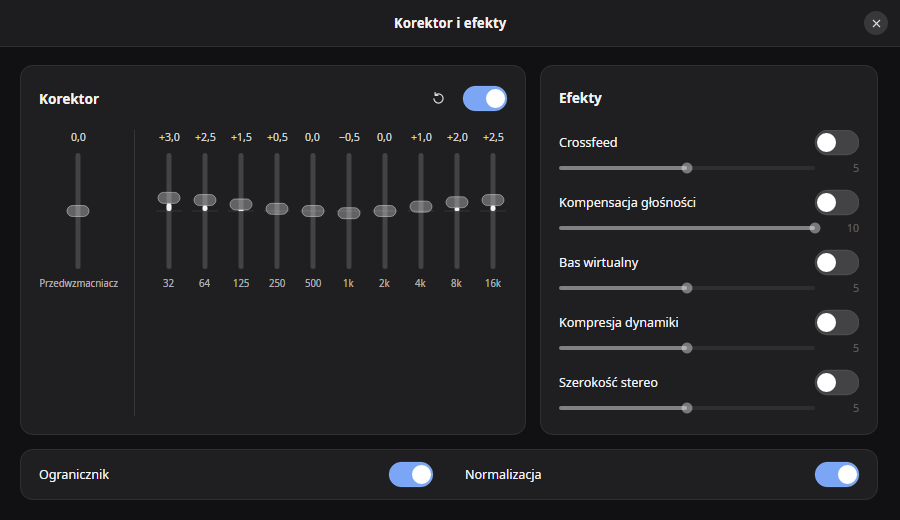

# Cewka

Minimalistyczny odtwarzacz muzyki dla Linuksa i Windowsa. Jeden plik, bez instalatora i bez
osobnego środowiska .NET.


*[English version](README.en.md)*


## Dlaczego to napisałem

Brakowało mi konfigurowalnego i ładnego odtwarzacza na moją Fedorę, więc zrobiłem go sam.
Chciałem czegoś, co po prostu gra pliki z dysku, ma korektor i dobrze wygląda, a do tego obywa się
bez biblioteki, konta i integracji z serwisami; poza odtwarzaniem stacji radiowych i opcjonalnym sprawdzaniem
wydań program nie łączy się z siecią.

Otwiera się w nim pliki albo całe foldery, a on układa je w kolejkę i gra. Tło okna bierze barwy
z okładki albumu.



## Możliwości

- MP3, FLAC, WAV, Ogg Vorbis i Opus. AAC, M4A i ALAC przez kodeki systemu: Media Foundation
  w Windowsie, GStreamer w Linuksie.
- Przejścia między utworami bez przerwy.
- Korektor dziesięciopasmowy z przedwzmacniaczem i ogranicznikiem.
- Pięć efektów, domyślnie wyłączonych: crossfeed do słuchawek, kompensacja głośności przy cichym
  słuchaniu, bas wirtualny, kompresja dynamiki i poszerzenie stereo.
- Wyrównanie głośności według znaczników ReplayGain albo własnego pomiaru EBU R128, do poziomu
  −23, −18 albo −14 LUFS.
- Listy odtwarzania M3U.
- Motyw jasny i ciemny, dwadzieścia języków interfejsu, w tym chiński uproszczony, japoński
  i portugalski brazylijski.
- Panel multimediów systemu (MPRIS w Linuksie, nakładka w Windowsie) i klawisze multimedialne.
- Obsługa z klawiatury i przez czytnik ekranu.
- Sprawdzanie nowej wersji, domyślnie wyłączone: Cewka pyta GitHuba o numer najnowszego wydania,
  najwyżej raz na dobę.
- Scena pełnoekranowa (F11, przycisk w pasku tytułu albo dwuklik w płytę): rozmyta okładka w tle, tytuł,
  pasek postępu i przyciski, które gasną po kilku sekundach bez obsługi. Klawisz V przełącza wizualizację:
  Płyta, Okładka, Noc, Widmo, Fala (linia albo stereo),
  Horyzont (obwiednia całego utworu z głowicą postępu) i Zorza (wstęgi światła w barwach okładki, rysowane
  shaderem; tylko z GPU i przy zasilaniu sieciowym). Widmo, Fala i Zorza mają ogranicznik błysków:
  jasność obrazu nie zmienia się tak, by przekroczyć trzy przejścia na sekundę. Przy ograniczonym ruchu zastępuje je Płyta,
  a Zorzę także na baterii. W ustawieniach (Scena) wybiera się wizualizacje pod klawiszem V, położenie,
  wyrównanie i marginesy napisów, wielkość płyty i okładki oraz efekty tła Płyty i Okładki w barwach
  okładki: plamy, poświatę, zabarwienie rozmycia i drobinki światła.
- Obsługa telewizora: wybór ekranu, na którym otwiera się scena, margines zapamiętywany osobno dla każdego
  ekranu (brak, 2,5% albo 5%; „Dopasuj krawędzie” pokazuje ramkę, którą ustawia się strzałkami), trzy
  wielkości tekstu, blokada wygaszania ekranu i ochrona OLED: powolny dryf obrazu, przygaszanie stałych
  napisów po trzech minutach bez obsługi i zamiana stron płyty i tekstu przy zmianie utworu, gdy przyciski są schowane. Odłączenie
  ekranu sceny zamyka scenę.
- Radio internetowe z wbudowaną listą ponad siedmiuset stacji (kraj, kategoria, wyszukiwanie, ulubione,
  ostatnio słuchane), własnymi adresami i importem list M3U i PLS. Stacje grają w MP3 i AAC, także
  przez HLS; tytuły utworów widać, gdy stacja je nadaje. Źródło przełączają Ctrl+1 (pliki) i Ctrl+2 (radio).
  Cewka łączy się wtedy z serwerami nadawców, które widzą
  adres IP: pobiera strumień wybranej stacji oraz, po zamknięciu jednorazowego baneru albo uruchomieniu
  stacji, logo widocznych stacji (tylko po HTTPS, z pamięcią podręczną na dysku). Bez ciasteczek,
  identyfikatorów i telemetrii. Całe radio wyłącza się w ustawieniach w Radio › Stacje, a pobieranie logo w Radio › Logo i prywatność.







Korektor z efektami otwiera się w osobnym oknie przyciskiem w prawym górnym rogu okna albo klawiszem Q,
a kolejka (w radiu lista stacji) wysuwa się po najechaniu na uchwyt przy prawej krawędzi okna, a klawisz L przypina ją na stałe. Te same ustawienia korektora i efektów są w ustawieniach
w Dźwięk › Korektor i efekty. Pozostałe skróty są w ustawieniach w O programie › Informacje. Ustawienia mają kategorie główne
(Ogólne, Dźwięk, Scena, Radio, O programie) z podkategoriami, a przy językach małe flagi. Pole nad
paskiem bocznym (Ctrl+F) przeszukuje wszystkie ustawienia. Tam też włącza się miękką pauzę, ustawia
tempo obrotu płyty, ruchu tła i opadania widma, długość listy ostatnio słuchanych stacji oraz
włączanie ostatniej stacji po uruchomieniu w trybie radia.






## Instalacja

Pakiety są na stronie [wydań](https://github.com/grelix/cewka/releases). Po instalacji program
pojawia się w menu aplikacji.

Fedora, RHEL:

```bash
sudo dnf install ./cewka-1.0.0-1.x86_64.rpm
```

openSUSE:

```bash
sudo zypper install ./cewka-1.0.0-1.x86_64.rpm
```

Debian, Ubuntu, Linux Mint:

```bash
sudo apt install ./cewka_1.0.0_amd64.deb
```

Arch, Manjaro:

```bash
sudo pacman -U cewka-1.0.0-1-x86_64.pkg.tar.zst
```

W Windowsie wystarczy pobrać `Cewka.exe` i go uruchomić. Plik nie jest podpisany, więc za pierwszym
razem pojawi się ostrzeżenie SmartScreen. Pobrany plik można porównać z sumą z `SHA256SUMS.txt`
dołączonego do wydania, na przykład poleceniem `Get-FileHash Cewka.exe` w PowerShellu.

### AAC, M4A i ALAC w Linuksie

Te formaty wymagają dekodera libav dla GStreamera. Bez niego pozostałe formaty działają normalnie.

```bash
sudo dnf install gstreamer1-libav        # Fedora, z RPM Fusion
sudo apt install gstreamer1.0-libav      # Debian, Ubuntu
sudo pacman -S gst-libav                 # Arch
```

## Budowanie

Potrzebny jest .NET SDK 10 i kompilator C: gcc w Linuksie, Visual Studio Build Tools w Windowsie.

```bash
./native/build-linux.sh
dotnet run --project src/Cewka.App -- ~/Muzyka/Album
```

Wydanie jednoplikowe i pakiety budują `./tools/publish-linux.sh` i `./tools/build-packages.sh`.
W Windowsie są to `native\build-windows.cmd` i `tools\publish-windows.cmd`.

## Z czego jest zrobiona

C# i [Avalonia](https://avaloniaui.net/). Dźwięk idzie przez [miniaudio](https://miniaud.io/),
który dekoduje też MP3, FLAC i WAV. Ogg Vorbis obsługuje [NVorbis](https://github.com/NVorbis/NVorbis),
Opusa [Concentus](https://github.com/lostromb/concentus), a pozostałe formaty, także AAC ze stacji radiowych, kodeki systemu. Wizualizacje rysuje Skia, dołączona do Avalonii.

## Licencja

MIT, treść w pliku [LICENSE](LICENSE). Noty składników są w [THIRD-PARTY-NOTICES.txt](THIRD-PARTY-NOTICES.txt),
a ich wykaz w [docs/licencje.md](docs/licencje.md). Zrzuty pokazują „Rhapsody in Blue” z okładką
pierwszego wydania nut z 1924 roku, która jest w domenie publicznej. Nagrania w kolejce i na zrzucie
wizualizacji pochodzą z Wikimedia Commons i też są w domenie publicznej: „The Charleston” (Golden Gate
Orchestra, 1925), „Semper Fidelis” (U.S. Marine Band, 1909), „Maple Leaf Rag” (Scott Joplin, rolka
pianoli z 1916 roku) i „Gymnopédie nr 1” Erika Satie w wykonaniu Robina Alciatore'a (Musopen).
